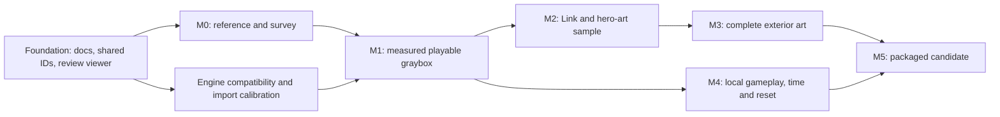

# Majoras — South Clock Town master plan

Planning baseline: 2026-11-08. Repository: `LouSputthole/Majoras`. User-selected visual direction: **faithful stylized remake**, with enhanced and expanded graphics/artwork. This is the execution index; the linked specialist documents carry the detailed contracts.

## 1. Intended deliverable

Deliver a standalone Windows Unity slice where the player can explore a recognizably faithful South Clock Town as young human Link, encounter a bounded set of local interactions and scheduled actors, see the cycle change the environment, observe the exterior tower opening, and exercise the defined reset/save behavior. Replace the original presentation with authored modern geometry, textures, animation, materials and lighting.

The first profile is **post-introduction exploration**, not the opening story sequence. Exact N64 release/revision remains to be selected. Default geography/gameplay comes from N64; 3DS images are labeled visual references. Neighbor districts, tower interior/rooftop, combat, dungeons, transformations, a complete quest system, multiplayer, console support and browser gameplay are outside this first slice.

Expanded detail initially means believable construction, depth, materials, backs of objects, richer animation and environmental dressing within the original route envelope. New interiors, relocated landmarks, wider streets, extra quests and new traversal are separate approved deviations, not hidden changes under a graphical upgrade.

## 2. What is actually done

| Item | State | Evidence / limit |
|---|---|---|
| New repository identified and local checkout connected | Complete locally | `origin` is the user's `LouSputthole/Majoras`; remote publication is recorded by the final commit/push |
| Engine/art/area/acceptance planning | Written and cross-reviewed | Five specialist documents below plus this backlog; plans are not implementations |
| Three.js layout reviewer | Implemented, locally verified | Production build, five contract tests, headless browser controls/export checks; `evidence/verification.json` |
| Shared layout and stable IDs | Implemented as proxies | 17 assemblies, five markers; **all placements/dimensions unmeasured** |
| Unity project seed and importer | Compiled in the editor | Both seed assemblies generated; no C# compiler errors; proxy generation/runtime checks still pending |
| Unity runtime/toolchain | Partially verified; automation blocked | Active Personal license and successful project open; Pipeline cannot start on `6000.5.0f1`; approved patch downloaded, Windows elevation pending |
| Reference game, exact coordinates and original state traces | Pending | No local game dump/reference session selected |
| Finished environment art | Pending | The review volumes are not finished architecture or a faithful clock face |
| Link concept/model/rig/animation | Pending | No generated concept asset or 3D character has been accepted |
| Original simulation or C# gameplay systems | Not implemented | Native bridge is a research alternative, not an existing integration |

Current progress is **foundation work supporting M0/M1**, not a passed M0 or playable M1. Unit/browser passes do not satisfy Unity, gameplay, visual-fidelity or performance gates.

## 3. Decisions and unresolved gates

| Decision | Working choice | Revisit / evidence required |
|---|---|---|
| Production engine | Unity 6, URP, desktop Windows first | License active; update incompatible editor patch, prove scene import and standalone build; lock supported version/packages |
| Browser role | Thin Three.js art/layout review and interchange | Never duplicate gameplay authority in JavaScript |
| Editable 3D sources | Blender, version to be pinned | Install availability and calibration export must be checked; not currently established |
| Portable review format | GLB | Validate format and orientation, then test Unity glTFast versus explicit FBX before production |
| Baseline geography | N64 South Clock Town | Match actual selected reference release; avoid N64/3DS bank/layout mix |
| Gameplay implementation | Small C# systems measured against reference | Native source bridge is optional gated research before broad content implementation |
| Source-game integration | No assumed drop-in compatibility | Reference build and C ABI feasibility experiment must pass first |
| Initial player profile | Young human Link, post-introduction sandbox | Opening story/Deku progression deferred |
| Input | Keyboard/mouse and gamepad planned | Map/rebind after actual Unity input spike |
| Performance | Provisional 1080p/60 desktop target | Name minimum/target machine and preset; measure frame times/memory, not viewer averages |
| Scope expansion | Visual detail inside existing routes | Record any geography/mechanics change in deviation ledger before implementation |
| Large art storage | Pending | Choose Git LFS/artifact storage before adding production binary history |

The current Unity seed uses built-in materials solely to avoid asserting that URP is configured. The installed `6000.5.0f1` compiled the seed but has a confirmed Pipeline startup defect. CLI `1.0.0-beta.17` requires editor `6000.5.3f1` or later. The user approved side-by-side patch `6000.5.11f1`; its download succeeded, but installation awaits Windows elevation after the first prompt expired or was cancelled. A compatible patch is not a long-term version endorsement. License activation is already complete; see `evidence/environment.json` for the current and historical results. `Unity/Tools/VerifyProxy.cs` is prepared and source-reviewed; runtime execution remains pending.

## 4. Milestone map and dependency order

Art can progress alongside local systems after the M1 contracts are stable. Do not wait for every decorative prop before testing time/reset. Do not mass-produce final assets before the character/import/tower sample passes. `E0–E6` in the architecture document are engineering gates within these milestones, not a competing project schedule.

| Milestone | Reviewable output | Required pass | Stop condition |
|---|---|---|---|
| M0 — Reference truth | Fixed version/profile, capture register, measured landmarks, routes, uncertainty/deviation records | Reproducible reference state; key anchors surveyed; version distinctions resolved | Missing data allows proxy work only; never declare layout fidelity |
| M1 — Playable graybox | Unity character motor, camera, collision, entrances and measured district | All route/camera/scale/coordinate checks; one real Windows build | Wrong geography, camera blockage, fall-through, scale/handedness error |
| M2 — Art benchmark | Link model/rig/locomotion, tower, ground/wall sample and day/night pair | Identity, deformation, export/reimport, fixed-camera and gameplay-clearance review | Link or tower identity unapproved; pipeline unstable |
| M3 — Exterior art | Complete area kit, working LODs/materials, props, sky/moon, lighting | Matching viewpoints and all prior route checks; no floating supports or depth instability | Art replacement changes routes, obscures navigation or fails performance budget |
| M4 — Local game systems | Selected interactions/NPC states, clock, opening, transition stubs, reset/save | Positive and negative paths, boundary crossing, re-entry, repeated reset/load | Duplicate rewards/actors, skipped events, timer/state disagreement, data loss |
| M5 — Candidate | Reproducible Windows package, review video, source/evidence inventory | All enabled acceptance cases, fresh-user launch, named hardware profile and visual sign-off | Any open P0/P1, missing build evidence, unreviewed fidelity claim |

## 5. Executable backlog

Status vocabulary: `done` = evidence exists for that limited task; `ready` = can begin independently; `blocked` = named dependency missing; `planned` = sequenced after prerequisites. Role is work ownership, not an assertion a human specialist has been hired. Every implementation task should land with its evidence/limitations and update this index.

### Foundation and reference

| ID | State | Task / deliverable | Depends on | Acceptance / owner |
|---|---|---|---|---|
| F-01 | done | Repository layout, dependency lock, ignores, CI definition | — | Local build and no game data in staging; engineering |
| F-02 | done | Proxy manifest, stable IDs, meter/axis adapter | — | Five contract checks pass; engineering |
| F-03 | done | Browser views, light presets, wireframe, markers, GLB download | F-02 | Headless renderer/control/export run; engineering |
| F-04 | done | Detailed engine, art, area, pipeline and acceptance plans | — | Cross-review resolves format/origin/state inconsistencies; lead |
| F-05 | blocked | Install approved compatible patch; license/open/seed compile verified | Local Windows elevation; installer already downloaded | Clean open/compile and standalone cube/character build; engineering |
| F-06 | ready | Pin Blender/exporter and art storage convention | Tool availability | Document actual versions, source/derivative retention and binary policy; technical art |
| R-01 | blocked | Identify local user-provided N64 reference dump and revision | Local reference path | Hash/version/profile recorded without committing game data; reference research |
| R-02 | planned | Pin zeldaret/mm and 2Ship source commits; build unchanged reference if used | R-01 | Exact revisions and unmodified behavior capture; engineering |
| R-03 | ready | Reference capture register and shot/route checklist | — | Fields include platform, build, day/time, form/story flags, camera uncertainty; research |
| R-04 | planned | Capture six fixed views plus complete district traversal | R-01,R-03 | Source captures reproducible and labeled; research |
| R-05 | planned | Survey tower, outline, elevations, thresholds and route widths | R-04 | Original units/normalized data, transform and uncertainty attached; level design |
| R-06 | planned | Survey flower, owl, mailbox, workers, dog, guard and postman states | R-04 | Selected actors' actual day/time/flag dependencies documented; research |
| R-07 | planned | Measure movement/camera/clock/interaction timing and reset fields | R-01 | Trace fixtures with tolerances; no remembered constants presented as fact; engineering |
| R-08 | planned | Lock N64 geography and explicit visual deviations | R-05,R-06 | Version-specific bank, routes and set dressing resolved; lead/user review |

### Engine and playable graybox

| ID | State | Task / deliverable | Depends on | Acceptance / owner |
|---|---|---|---|---|
| E-01 | done | Unity seed and JSON-envelope importer authored and compiled | F-02 | Source review and editor assembly generation; scene generation still pending; engineering |
| E-02 | blocked | Execute seed import; configure URP/input and Windows target | F-05 | No console errors; materials/scale correct; package lock committed; engineering |
| E-03 | planned | Asymmetric calibration fixture with skin, clip, alpha and normal map | F-06 | One-meter measurements and source export record; technical art |
| E-04 | planned | Compare GLB/glTFast and FBX Unity import paths | E-02,E-03 | No mirror, double Z flip, bone or tangent error; reimport preserves bindings; technical art |
| E-05 | planned | Add GLB load/review to web tool, report asset ID/revision | E-03 | Same source/export hash reviewed; missing assets fail visibly; engineering |
| E-06 | planned | Establish C# core/runtime/presentation assembly boundaries | E-02 | No engine-object references in durable state; engineering |
| E-07 | planned | Measured ground, stairs, walls and simplified collision | R-05,E-04 | Full route graph traversable; collision independent from final art; level design |
| E-08 | planned | Kinematic motor/input using labeled provisional tuning | E-06,E-07,R-07 | Corner, slope, step, ledge and dropped-frame tests; engineering |
| E-09 | planned | Follow/orbit/recenter/occlusion camera | E-08 | Fixed-camera route review, no geometry clipping or lost target; engineering |
| E-10 | planned | Stable scene/entrance IDs and labeled neighbor stubs | E-06,E-07 | Exit/re-entry safe spawns and consistent state; engineering |
| E-11 | planned | Debug state/clock/route tools, isolated from release saves | E-06 | Resettable reproducible fixtures; debug state labeled; engineering |
| E-12 | planned | M1 Windows graybox package | E-07–E-11 | Keyboard/mouse and gamepad route video; engineering/user feel review |
| X-01 | optional | Bounded native 2Ship bridge feasibility spike | R-02,F-05 | Source stepping, snapshot, collision authority, save/reset/reload gates; see architecture §10 |

Do X-01 **before broad systems/content expansion** if retaining source simulation is a priority. Its proposed five engineering-day budget is a research stop/go timebox, not a delivery estimate. Do not build two production authorities. No native integration is currently present.

### Young Link and hero-art benchmark

| ID | State | Task / deliverable | Depends on | Acceptance / owner |
|---|---|---|---|---|
| L-01 | ready | Chosen-release Link reference sheet and proportions checklist | R-01 for direct captures | Front/profile/rear and equipment identity recorded; character art |
| L-02 | planned | Modern faithful concept/turnaround | L-01 | Recognizable young Link, consistent costume and silhouette; user art review |
| L-03 | planned | Body/clothes/head high-detail sculpt and hair masses | L-02 | 3D turntable maintains approved proportions; character art |
| L-04 | planned | Retopology, UVs, bake cage, material authoring | L-03,E-04 | Joint loops, UV/normal/roughness checks, no hidden bake artifacts; character art |
| L-05 | planned | Rig with roots, facial setup and sword/shield sockets | L-04 | Bind-pose and extreme deformation suite, correct scale; rigging |
| L-06 | planned | Idle, walk, run, start/stop, turn and interaction clips | L-05,E-08 | Contact, speed matching, transitions and loops; animation |
| L-07 | planned | Unity prefab, locomotion bindings, camera framing and LODs | L-06,E-09 | No foot slide/ground penetration/attachment drift in game; technical art |
| L-08 | planned | Link benchmark review | L-07 | Neutral light, day/night, turntable and actual gameplay-camera evidence; user art review |
| A-01 | planned | Tower silhouette and separately pivoted mechanisms | R-05,E-04 | Six-view comparison; reference scale and hierarchy; environment art |
| A-02 | planned | Representative ground/wall/thatch/timber/cloth/brass material kit | A-01 | Reads at player distance; portable base maps; environment art |
| A-03 | planned | Day/night lighting benchmark | A-01,A-02 | Mood and readable routes; correct Unity render evidence; lighting |
| A-04 | planned | M2 art approval packet | L-08,A-03 | Freeze benchmark before duplicating production assets; lead/user |

Upscaling a texture is an optional material subtask, never a substitute for L-03–L-07. A generated concept image is a design reference, not a rigged mesh. Original topology/UV/animation reuse would require its own extraction, compatibility and provenance decision; none is assumed here.

### Exterior production

| ID | State | Task / deliverable | Depends on | Acceptance / owner |
|---|---|---|---|---|
| A-05 | planned | Ground and perimeter kit, elevations, trim and patterns | A-04,E-07 | Original enclosure/clearances retained; no coplanar overlay flicker; environment art |
| A-06 | planned | Thresholds, doors, recesses, backs and roofline | A-05 | Free-camera views plausible without adding new routes; environment art |
| A-07 | planned | Scaffold/platform assemblies and state variants | R-06,A-05 | Braced supports meet ground; per-day collision/visibility coherent; environment art |
| A-08 | planned | Stalls, crates, thatch and restrained dressing | A-05 | Anchored supports, preserved route envelope and silhouettes; environment art |
| A-09 | planned | Banners, painted civic graphics, signs and attachment motion | A-06,A-07 | Motifs, sag, thickness and mip stability; environment art |
| A-10 | planned | Owl, mailbox, flower and gate/guard visual fixtures | R-06,A-05 | Correct identities, locations and interaction clearances; environment/character art |
| A-11 | planned | Moon/sky/fog, spotlight and time-of-day cues | A-03,R-04 | State-labeled comparison views; night readability; lighting |
| A-12 | planned | Minimal selected NPC visual/animation kit | R-06,L-05 | Scale, silhouette and motion agreed; no fake schedule claim; character art |
| A-13 | planned | LODs, instancing, texture compression and bounds | A-05–A-12 | Stable silhouettes/contact/shadows at transitions; measured budget; technical art |
| A-14 | planned | M3 exterior art review | A-13 | All traversal checks repeated with final art; user visual review |

### Local game systems

| ID | State | Task / deliverable | Depends on | Acceptance / owner |
|---|---|---|---|---|
| G-01 | planned | Integer cycle clock, pauses, speed policy and boundary events | R-07,E-06 | Frame-rate-independent outcomes; skipped-boundary tests; engineering |
| G-02 | planned | Interaction targeting, approach/facing and cancel state | E-08,E-09 | No through-wall/out-of-range activation; engineering |
| G-03 | planned | Minimal dialogue, inventory and cycle/permanent flag model | E-06,R-07 | Data/state separate from animation/UI; engineering |
| G-04 | planned | Town Business Scrub exchange using controlled fixture inventory | G-02,G-03,R-06 | Moon's Tear consumed/deed granted exactly once; repeat/cancel/re-entry tests; engineering |
| G-05 | planned | One source-backed NPC schedule/path plus worker state variants | G-01,R-06,A-12 | Correct arrival/departure/state at boundaries; no arbitrary wander substitute; engineering |
| G-06 | planned | Gate restrictions and bounded owl/mailbox interactions | G-02,G-03,R-06 | Implement only recorded profile semantics; clearly stub omitted mechanics; engineering |
| G-07 | planned | Exterior clock parts and Final Day opening | G-01,A-01 | Correct closed/open state, cues, colliders, re-entry and seek handling; engineering/animation |
| G-08 | planned | Scene transition state machine | E-10,G-03 | No duplicate actors/events; safe cancel/failure path; engineering |
| G-09 | planned | Versioned save DTOs and per-field persistence table | G-01,G-03,R-07 | No live Unity object serialization; compatibility validation; engineering |
| G-10 | planned | Atomic save write/restore and interrupted-write recovery | G-09 | Valid prior generation survives interrupted/corrupt writes; engineering |
| G-11 | planned | Cycle reset transaction and generation-based event cancellation | G-05,G-07–G-10 | Repeated reset/load with no duplicated rewards/actors or stale callbacks; engineering |
| G-12 | planned | Bounded UI, audio cues and input/settings behavior | G-01–G-11 | Presentation reads authoritative state; no external music assumed; engineering/audio |
| G-13 | planned | M4 local systems validation | G-12 | Acceptance INT/NPC/TIME/TOWER/RESET/SAVE cases; QA |

Fixture-granted items support testing only. They do not claim the Observatory, item acquisition quest, entire deed chain, full mail delivery or complete save semantics have been rebuilt.

### Candidate verification

| ID | State | Task / deliverable | Depends on | Acceptance / owner |
|---|---|---|---|---|
| Q-01 | ready | Name target/minimum hardware, display and preset | User/device decision | Record CPU/GPU/RAM/resolution; actual budget owner |
| Q-02 | planned | Profile representative route/day/night/busy state | A-14,G-13,Q-01 | Frame-time distribution, memory and profiler capture; engineering |
| Q-03 | planned | Ground-contact and moving-camera depth audit | A-14 | No floating prop bases, near/far flicker or LOD popping on named route; QA |
| Q-04 | planned | Save/reset/re-entry and extended play soak | G-13 | No growth, duplicated state, data loss or blocking regressions; QA |
| Q-05 | planned | Rebuild from clean checkout and launch clean user profile | Q-02–Q-04 | Pinned versions, reproducible package, correct save directory; engineering |
| Q-06 | planned | Paired source/remake captures and known deviations | R-08,Q-05 | Fidelity reviewed separately from technical green checks; user/lead |
| Q-07 | planned | M5 release candidate handoff | Q-06 | Video, package/hash, instructions, no open P0/P1; user review |

## 6. Asset-family order

1. Calibration fixture and scale guide.
2. Link proportions and tower silhouette; these set character/world identity.
3. One ground/wall/stall sample plus lighting pair to prove the material language.
4. Ground/perimeter/thresholds, then scaffold and mechanisms.
5. Link rig/locomotion in the same environment, not in an isolated turntable only.
6. Stalls, banners, owl/mailbox/flower/gate fixtures, then selected NPCs.
7. Moon/sky/time variation, dressing and controlled effects.
8. Optimization and depth/contact audit after visual approval.

See [ART_DIRECTION.md](docs/ART_DIRECTION.md) for palette/silhouette rules and [ASSET_PIPELINE.md](docs/ASSET_PIPELINE.md) for the full source→export→Unity sequence. Each asset has separate reference, concept, mesh, rig, browser, Unity, performance and approval states. Nothing becomes finished because a screenshot looks plausible.

## 7. Risks and mitigations

| Risk | Mitigation | Proof required |
|---|---|---|
| Polished approximation mistaken for the actual district | Keep proxy labels; survey before geometry lock | Paired views, measured anchors and route graph |
| Two engines become two games | Only Unity owns simulation | Code boundaries; reviewer contains no durable gameplay |
| Native bridge absorbs unlimited effort | Optional timeboxed spike with explicit stop/go | Step/reset/save/pose lifecycle and clean build |
| Link concept cannot become a usable character | Approve proportions, then deformation/import before final texture detail | Rig stress suite plus real locomotion |
| Final art breaks movement | Freeze collision envelope and repeat route tests after replacements | Traversal checks on authored art |
| Floating props or flickering ground | Support/pivot contracts, separate collision, avoid duplicate coplanar faces, audit depth/LOD/shadows | Moving-camera recordings at near/far/day/night |
| Schedules/time behave differently at lower FPS | Integer clock and explicit crossed-boundary policy | Normal/reduced/irregular-FPS traces |
| Reset duplicates rewards or preserves wrong flags | Versioned per-field policy, cycle generation, idempotent state reconstruction | Negative and repeated reset/load tests |
| Art scope grows before pipeline works | M2 benchmark gate before mass production | Approved character/tower/material test set |
| Documentation outpaces implementation | Link each completed task to dated evidence | Status table updated per commit; no invented passes |

## 8. Review cadence and definition of ready/done

At the start of each implementation batch: select a small dependency-complete group, name owned files/assets, link relevant acceptance IDs and record assumptions. At the end: run necessary automated checks, capture relevant actual-runtime evidence, record remaining limitations, and request artistic/feel review only on something concrete.

An engineering task is ready when reference/contract inputs exist or are explicitly provisional. It is done when the code and required runtime behavior are verified with reproducible evidence. An art task is ready when identity, scale and import constraints are established. It is done when source files, exports, metadata, actual Unity render/deformation checks and the required visual review all exist.

Use the acceptance IDs in [ACCEPTANCE.md](docs/ACCEPTANCE.md). P0/P1 defects block a candidate. Visual fidelity, gameplay parity, package reproducibility and performance are separate decisions. Avoid estimated calendar promises until reference access, Unity runtime validation and the asset spike establish actual throughput.

## 9. Immediate next work

1. Resolve the confirmed editor/Pipeline compatibility issue with an approved patch update; the Personal license is already active. A local reference-game path is still needed when available. Neither credentials nor game data goes into GitHub.
2. Run F-05/E-02 to prove a real Unity project and Windows player; record version/packages.
3. Run F-06/E-03/E-04 on the calibration fixture before building polished Link/town assets.
4. Run R-01–R-08 and replace the current authored proxy with measured layout data.
5. Build E-07–E-12 as the first playable South Clock Town graybox.
6. Review L-02 and A-01 as the first art-direction checkpoints, then produce M2.

Independent work while Unity automation is blocked: reference planning/capture indexing, source-behavior research, art references and catalog, browser import validation, and reviewed native-bridge dependency mapping. A compiled seed does not establish successful scene generation, play mode or a player build.
