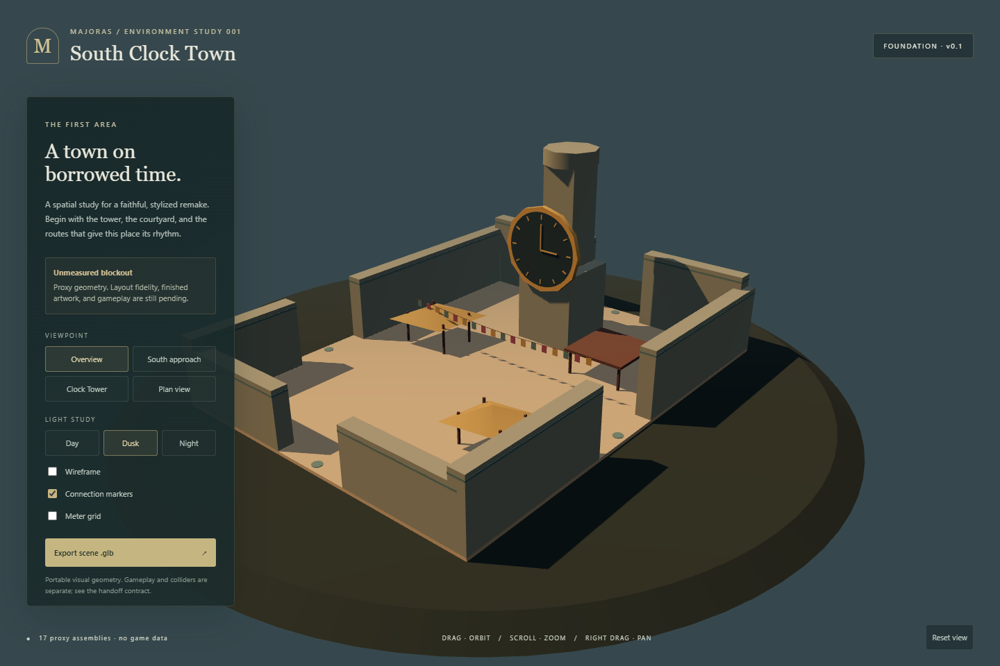

# Majoras

A faithful, stylized Majora's Mask remake study, beginning with **South Clock Town and young Link**. The intended result is a playable Unity scene with modern authored models, materials, lighting and animation, preserving the area's identity and selected N64 behavior.

**Current state: planning and foundation.** There is a working Three.js layout reviewer, an unmeasured shared blockout, and an uncompiled Unity seed. There is no finished Link model, imported original simulation, or playable Unity remake yet.

## Start here

Read **[PROJECT_PLAN.md](PROJECT_PLAN.md)** for the complete milestone sequence, dependency-ordered task backlog, current status, blockers, decisions and next work. Supporting plans:

| Document | Covers |
|---|---|
| [Engine architecture](docs/ENGINE_ARCHITECTURE.md) | Unity vs browser responsibilities; C# vs native simulation; coordinates, lifecycle, saves and integration gates |
| [South Clock Town specification](docs/SOUTH_CLOCK_TOWN.md) | Reference versions, landmarks, routes, scope, survey and local gameplay |
| [Art direction](docs/ART_DIRECTION.md) | Faithful shapes, materials, palette, atmosphere, young Link and expansion rules |
| [Asset pipeline](docs/ASSET_PIPELINE.md) | Modeling, retopology, UVs, rigging, animation, LODs, provenance and export/import |
| [Acceptance plan](docs/ACCEPTANCE.md) | Concrete traversal, visual, schedule, reset, save, performance and build checks |
| [Unity seed](Unity/README.md) | What exists, how to generate the proxy, and what remains unverified |

## Run the layout reviewer

Node 24 is the verified local runtime. From the repository:

```powershell
cd prototype
npm ci
npm run dev
```

Open http://127.0.0.1:4173. Drag to orbit, right-drag to pan, scroll to zoom. View presets, lighting, wireframe, connection markers and a meter grid support layout review. Select geometry to inspect its stable ID. **Export scene .glb** downloads authored proxy geometry for interchange testing; this does not export gameplay, a Unity scene, or engine colliders.



The image above is the actual reviewer, not target art. Its conventional clock, flat courtyard and simple volumes are intentionally temporary. They must be replaced from measured references before fidelity or final-art approval.

## Verify

```powershell
cd prototype
npm test
npm run build
npm run preview
```

In another terminal, run `npm run verify` from `prototype`. Local verification uses installed Chrome headless. CI installs Playwright Chromium on a pinned Ubuntu 24.04 runner. The verifier checks WebGL output, controls, export hierarchy, units/axis conversion, console errors and compact layout. Local results and screenshots go to `evidence/`; CI writes only to `evidence/ci/` and uploads that run's artifacts. A failed run cannot reuse a committed local pass report. The Khronos semantic GLB validator and Unity round trip are future import-spike work; the current export check validates the binary envelope, JSON structure and selected transforms only.

## Engine choice

**Unity owns the future game. Three.js owns the review tool.** The browser will not acquire a second copy of player physics, NPC schedules, quests or save logic. Production target is Unity 6/URP on Windows, subject to the toolchain/import spike. Original C code is a behavioral reference or a separately gated native-bridge experiment, not code that can automatically be pasted into Unity.

Unity `6000.5.0f1` is provisionally recorded in the seed because it is installed locally. The actual bootstrap failed with `No valid Unity Editor license found` (exit 198). Activate the editor through Unity Hub before running Unity checks. Editor support/version and URP packages must be locked after that succeeds.

## Source and data boundaries

N64 layout/gameplay is the working baseline; labeled 3DS references may inform artwork. No original ROM, extracted assets, save data or source-game runtime is in this repository. Reference captures used locally are not automatically publishable art. Future copied upstream code needs exact source revisions and notices recorded. New art remains tracked separately from reference evidence.

The current scene uses meter-based **proxy dimensions**, not measured game dimensions. The authoritative file is [shared/scenes/south-clock-town.blockout.json](shared/scenes/south-clock-town.blockout.json). Preserve its stable IDs while replacing geometry. See [evidence/verification.json](evidence/verification.json) and [environment record](evidence/environment.json) for the limits of current verification.
