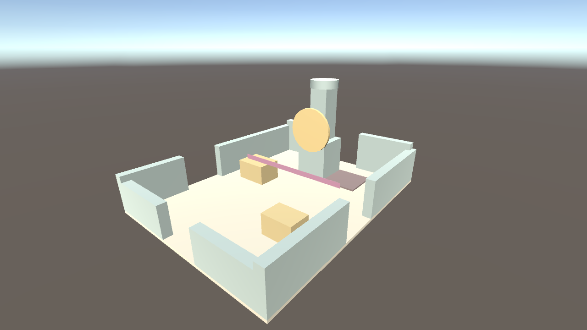

# Unity scene and local N64 reference

## Current environment MVP

After the reported lockup, start with the [developer handoff](../docs/HANDOFF.md) and [full-city plan](../docs/FULL_CITY_PLAN.md). The current implementation includes uncommitted source and ignored local inputs. The build exists, but visible Windows launch/physical input remain unresolved; read the evidence limits before restarting a verification run.

Open `Assets/LocalReference/SouthClockTown/Enhanced/SouthClockTown_MVP.unity` and press Play. Use **Begin exploring**, WASD/mouse, Shift to run, Space to jump, Tab to compare, 1/2 for day/dusk, R to reset, Esc to pause, F1 for the HUD. The local build is `Builds/CityMVP/MajorasCityMVP.exe`; its precise launch status is in [MVP_REVIEW.md](../docs/MVP_REVIEW.md).

**Majoras > Build Local City MVP** regenerates the disposable enhanced scene from the preserved source reference and four local painted textures. The generator refuses dirty scenes and active Play Mode. Source assets, enhanced assets, screenshots and Windows binaries stay local and ignored. The tracked generator/shaders/controllers and verification scripts are reusable. See [city playbook](../docs/CITY_PLAYBOOK.md) and [iteration log](../docs/ITERATION_LOG.md).

The historical proxy instructions below apply only to the old engine smoke test. They do not describe the current walkable preview.

## Original reference and historical proxy

The current scene is the imported original South Clock Town reference, saved locally at `Assets/LocalReference/SouthClockTown/Generated/SouthClockTown_RomReference.unity`. Use **Majoras > Import Local ROM Reference** to regenerate it from the prepared local inputs. It includes the original room, clock assembly, doors and Day 1 platform; 21 render meshes and the room collision passed the editor/Play Mode checks. This is the baseline for rebuilding the art, with no character controls yet. [Conversion instructions](../tools/reference/README.md) explain dependencies, source pins and remaining fidelity limits. ROM-derived assets and captures are ignored by Git.

The earlier proxy's checks and Windows build are recorded below; that executable still displays the old boxes and does not contain the new reference scene.

Verified on 2026-11-08 with Unity **6000.5.11f1** (`5c3a1087d8e4`), CLI `1.0.0-beta.17` and Pipeline `0.10.0-exp.1`. The approved side-by-side patch fixed the Pipeline startup defect in `6000.5.0f1`; the older editors remain installed. The user activated Unity Personal and accepted the updated editor terms.

The seed compiles, generates South Clock Town, and passes inspection after initial generation, saving/reopening and regeneration: 17 unique IDs, 13 box colliders, correct proxy transforms/materials and ground contact. Play Mode advances frames and simulation time. A Windows development build succeeded with zero build warnings/errors, launched in graphics-enabled batch mode, loaded all 17 identities, advanced time, and rendered a camera capture identical to the editor capture. See [environment evidence](../evidence/environment.json).

This is an **unmeasured static blockout**, with built-in Standard materials. It has no Link character, movement controller, gameplay, final art, configured URP, or Input System yet. Batch-mode execution and an off-screen capture do not establish interactive traversal, final appearance, performance, or a clean-checkout build.

1. Open this `Unity` directory in the pinned editor.
2. Run `unity status --until-ready --project-path <repo>/Unity` and confirm a ready connection.
3. Invoke `Majoras.Editor.ImportSouthClockTown.Generate()` through the connected editor, or choose **Majoras → Generate South Clock Town Proxy**. The tool offers to save any modified scene before replacing it. Regenerating replaces the disposable proxy scene.
4. The importer reads `../shared/scenes/south-clock-town.blockout.json` relative to this project and creates `Assets/Scenes/SouthClockTown_Proxy.unity` plus generated materials.
5. Run the verified [proxy inspection script](Tools/README.md), inspect the render, then repeat after saving/reopening.
6. Open the generated scene and press Play for its fixed-camera view. There are no gameplay controls yet; URP/input and a player are the next engine tasks.

The local build is `Builds/Windows/MajorasProxy.exe`, with its required adjacent data/DLL files. Double-click it to view the static proxy window. Generated assets and builds are ignored; the executable alone is not a complete package.

To reproduce the build through Pipeline, target `StandaloneWindows64`, output `Builds/Windows/MajorasProxy.exe`, options `Development` and `DetailedBuildReport`, and the explicit scene array containing `Assets/Scenes/SouthClockTown_Proxy.unity`. Invoke `build run` with `confirm=true`, then poll `build status` until completed and inspect its result. Discover the exact schema with `unity command --query "build run" --detail full --project-path <repo>/Unity`; array arguments are JSON and need native-argument quote escaping in Windows PowerShell 5.1.

For the recorded standalone inspection only, Pipeline's **Enable in Development & Profiled Builds** toggle was temporarily enabled before building. The player was launched with `-batchmode` and a local log file. Runtime calls used `--runtime-path <repo>/Unity/Builds/Windows` (the **directory**, not the descriptor file). This runtime does not expose the editor's `capture game_view` command; [CaptureProxyPlayer.cs](Tools/CaptureProxyPlayer.cs) performs an off-screen render through supported C# evaluation. Runtime instrumentation was restored to disabled and saved afterward; release instrumentation stayed disabled. The existing local development binary still contains its loopback-only test instrumentation.

The CLI executable in this local session is `C:\Users\cargi\AppData\Local\Unity\bin\unity.exe`; use the full path if the terminal has not picked up the installer PATH change. Target this project explicitly when multiple editors are open. Sanitized results are in `../evidence/environment.json`; raw logs remain local and ignored.

The importer uses Unity coordinates directly. Do not reflect Z again. The browser adapter reflects Z once when producing right-handed Three.js/glTF geometry. Real GLB imports need a pinned importer and the calibration spike; Unity does not automatically load this viewer's GLB as a configured game scene.

Shelters and bunting are simple **envelopes** in this Unity seed, while the browser shows decorative proxy components. The construction platform has no authored supports. Neither representation establishes finished art/collision or a passing floating-support/depth audit. Cylinder envelope colliders are explicitly boxes instead of Unity's default capsule collider. Built-in Standard roughness maps to `_Glossiness`; future URP materials map to `_Smoothness` and require explicit shader migration.

The generated proxy is disposable. Final measured scenes/prefabs must live outside the ignored generated filenames. Source/folder `.meta` files, project settings and the package lock are tracked. The menu importer is editor-only; `ProxyAssetIdentity` stores metadata, not gameplay state. Raw logs, generated build-only assets and runtime connection descriptors remain local and ignored.
