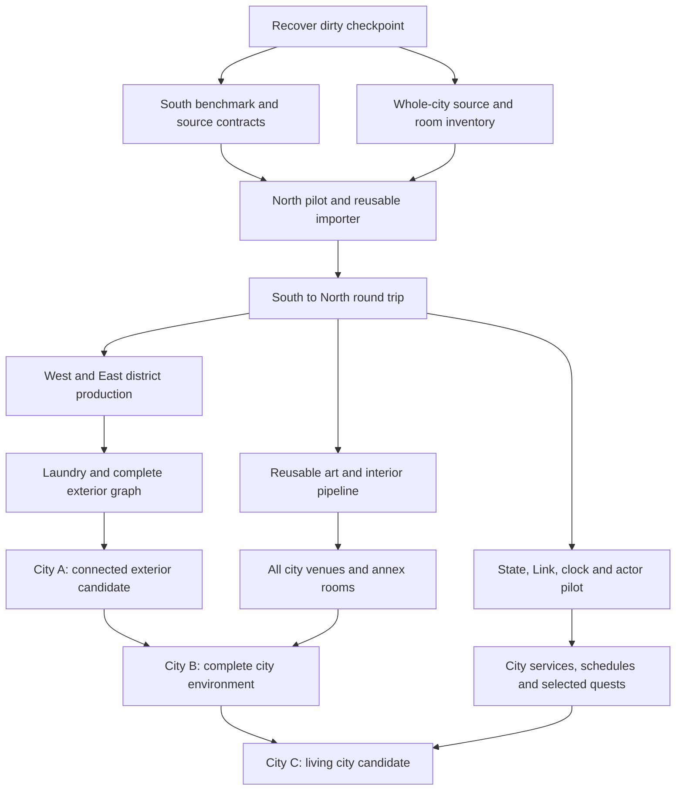

# Full Clock Town execution plan

Planning revision: 2026-11-08, after the reported computer lockup. Owner request: give the next developer a detailed plan for the entire city and its legwork. **This is future work unless a row explicitly cites existing evidence.** Start with [HANDOFF.md](HANDOFF.md) for the recovered checkout, then use the task IDs here to assign work. [MVP_REVIEW.md](MVP_REVIEW.md) is the current preview evidence ledger.

This plan extends the earlier South-only scope in [PROJECT_PLAN.md](../PROJECT_PLAN.md). It retains that document's South/Link tasks and the specialist art, source, architecture and acceptance contracts. The extension is all five exterior areas, their city venues and connecting spaces, followed by city-wide presentation and behavior. It does not require restarting South or finishing the whole game's dungeons before the city becomes useful.

## 1. Product target and meaning of complete

Build a faithful, stylized modern Clock Town that the player can explore as a coherent place: recognizable district layouts, distinctive buildings, readable routes, enterable venues, credible construction, coherent lighting and sound, and eventually source-backed inhabitants and three-day changes. New geometric depth and authored surface detail should explain the original design. Do not change the original route graph simply to make modular construction easier.

Use three explicit delivery levels so a partial pass remains useful without being mislabeled:

| Delivery | Included | Completion evidence |
| --- | --- | --- |
| **City A: connected exterior exploration** | South, North, West, East and Laundry Pool; every surveyed exterior connection; source-aligned collision; authored environment benchmark propagated across the districts; safe labeled boundaries to unfinished content; daylight/dusk/night review profiles | One packaged traversal through all five regions and back; every enabled portal tested both directions; per-district comparison packet; known omissions listed |
| **City B: complete city environment** | City A plus surveyed city interiors, multi-room buildings, underground/observatory annex, tower interior and rooftop presentation; source-selected variants; full replacement-art inventory; complete city sound/lighting pass | All in-scope rooms reachable through real entrances, all scenery/asset rows accounted for, spatial and visual review passed; remaining interaction restrictions visible |
| **City C: living city slice** | Young Link/controller/camera; residents, schedules, clock/calendar, doors/services, selected activities and quest chains, cycle reset/save continuity, opening/final-night presentation | Full declared behavior matrix and boundary tests; no duplicate actors/rewards; replayable cross-district scenarios; actual player and owner review |

City B is the environment-complete target, not five facades with inaccessible destinations. City C is the behavioral target, not a crowd wandering randomly. Exterior-first delivery is sequencing, not permission to quietly omit interiors from the full plan.

The broader Termina overworld, dungeons, complete combat/transformation campaign, final boss and unrelated regions are outside this city program. Preserve their entrance IDs and honest boundary behavior. If a city quest depends on an outside event, model that dependency explicitly and provide a clearly labeled development fixture until the outside region exists. Do not claim the quest is playable end-to-end with a debug flag standing in for that segment.

**Baseline:** N64 US revision 0. Source profile begins at Day 1 noon with the normal room header and closed tower. Preserve the compressed geography and N64 venue placement. Later day/time/story variants are separate indexed states. A 3DS image may inform an explicitly recorded treatment; it cannot silently move a bank, opening, prop or route.

## 2. Delivery order and gates



The North connection must work before producing all the remaining district integration code. Inventory of every district and interior can proceed early. Production art may proceed after the tower/material/import benchmark; it must not wait for every quest. Time/state work begins with a small cross-district actor pilot before final city art is complete, because lifecycle mistakes are expensive to discover late.

| Gate | Required output | Reject or stop expanding when |
| --- | --- | --- |
| G0 Recovery | Reviewed source checkpoint; local inputs/logs inventoried; exact code versus package state known | Untracked work would be lost, the scene depends on missing local inputs, or evidence is attributed to the wrong build |
| G1 South reusable benchmark | Source-aligned tower/ground/stall cluster; approved material direction; preserved movement envelope; actual import and render checks | More texture detail conceals bad geometry/UVs; contacts float; source transforms are uncertain |
| G2 North pilot | First generalized region manifest and repeatable North import; South unchanged; one real portal round trip | Importer silently drops actors/material states, reimport breaks IDs, or portal arrival is unsafe |
| G3 Exterior network | All five exterior districts and every surveyed edge; collision, safe arrival and comparison coverage | Any enabled route has a softlock, wrong destination, invalid ground, duplicate player or missing ownership |
| G4 Interior pipeline | One commercial room, one multi-room venue and one special space pass import, lighting and entry/return | Each room needs a bespoke importer, door bookkeeping diverges or local state resets unintentionally |
| G5 Environment complete | City B inventory closed; authored art and approved exceptions recorded; package and performance profile | Placeholder/source-derived content is concealed in the completion claim, or rooms/routes remain unaccounted for |
| G6 Living city | City C scenario matrix passes; clock, actors, services, quest state and reset/load agree | Re-entry duplicates an actor/reward, clocks disagree, or a debug shortcut is required for a claimed playable path |

Keep the current Built-in renderer for recovery and the North source pilot. Before multiplying final materials, the integration owner runs an isolated renderer decision spike. Either qualify an URP migration with actual material/build/route checks or record a deliberate Built-in target for this city release. Do not leave every artist guessing between two renderer contracts. The new Input System and gamepad work similarly need an assigned migration packet and regression evidence, not a project-wide settings change during source indexing.

## 3. Source-of-truth inventory and proposed data contracts

The next developer should make the city enumerable before making it decorative. Use the local pinned `mm-decomp` scene table, scene XMLs, extracted scene/room data, actor initialization/draw behavior and reproducible in-game captures together. XMLs provide discovery metadata; they do not establish final actor visibility or schedules.

### 3.1 Proposed artifact layout

These paths are a contract proposal, **not files already implemented**. Confirm them in PIPE-01. Use the same stable IDs in JSON records, Unity bindings, evidence and future saves.

```text
docs/city/
  LOCATION_REGISTER.md          all exteriors, venues, rooms and annexes
  SOURCE_REGISTER.md            revisions, source profiles and reference capture index
  PORTAL_REGISTER.md            both endpoints, source evidence, conditions and unknowns
  DEVIATIONS.md                 intentional artistic/spatial/behavioral changes
  districts/<district-id>.md    source inventory, work packet, route and acceptance notes
  interiors/<venue-id>.md       room/door/state inventory and asset packet
shared/city/
  schema/                      versioned region, portal, camera and asset schemas
  regions/<region-id>.json      metadata, coordinate frame, room/actor assembly records
  portals.json                 directed endpoint pairs and availability predicates
  cameras/<region-id>.json      repeatable capture poses and profiles
  routes/<region-id>.json       controller waypoints, checkpoints and expected support
art/
  catalog.json                 follows ASSET_PIPELINE.md; all required assets accounted for
  sources/...                  authored editable sources under chosen binary-storage policy
  exports/...                  versioned authored review/Unity exports
Unity/Assets/
  City/                        proposed runtime data and authored scene compositions
  Art/                         authored, imported production assets
  Prefabs/                     wrappers, collision, sockets, durable bindings
  LocalReference/<region>/     ignored extracted reference/generated comparison content
evidence/city/<run-id>/         compact sanitized results and authored comparison evidence
local-reference/<region>/      ignored source-derived captures, extracts, logs and DCC files
```

Do not put ROM geometry, texture bytes or extracted actor arrays into `shared/city` merely because they fit JSON. Keep bulk source-derived payloads under ignored reference paths. Tracked records contain IDs, source citations, local input labels/hashes, authoring metadata and reviewed measurement/placement records as appropriate. Authored replacements keep provenance separate from their local reference.

### 3.2 Region record

Each region needs: schema version; stable region ID; display label; source scene symbol; exact source/tool revision; selected header/room/profile; local source input hashes; source coordinate frame and one conversion matrix; authored registration matrix; provisional physical scale flag; source and Unity bounds; at least three surveyed anchors including elevation; room list; visible actor/component list; collision ownership; portal IDs; material bindings; selected camera/route IDs; omissions; unsupported features; evidence; and independent readiness statuses.

Give each actor entry a stable source key such as scene/header/room/entry-index plus its decoded source actor ID/params. Give authored assemblies their own durable IDs; do not use a material index, filename, Unity instance ID or English label as the durable identity. An actor may produce several components or no visible mesh. Keep component transforms distinct from actor transforms.

South's existing IDs remain valid, including `scene.south_clock_town` and the existing `sct.*` proxy IDs. Add the new city namespace through an explicit mapping; do not rename all old IDs as cleanup. A source-reference instance and an authored replacement may share a correspondence ID while keeping different asset/provenance records.

### 3.3 Portal record

Each directed portal needs: unique ID; from/to scene IDs; local source entrance/exit symbols and decoded values; source polygon or door trigger evidence; departure bounds/plane and normal; destination entrance ID; safe arrival feet pose and facing; clearance/support probe; mode (`district`, `door`, `room`, `special`, `external-boundary`); day/time/story/form conditions; lock/rejection presentation; loading presentation; reverse endpoint or explicit one-way reason; activation/re-entry policy; and test results.

The two South-to-East approaches and two South-to-West approaches must remain distinct. Eight current boundary labels do not mean eight implemented destination scenes. Numeric entrance-table indices and ordinary scene-table enums are different namespaces; preserve the decoding already documented in [CITY_PLAYBOOK.md](CITY_PLAYBOOK.md#eight-source-derived-day-1-preview-boundaries).

Required graph checks: IDs unique; destination exists or is explicitly unavailable; enabled endpoints resolve; reciprocal connections are documented where expected; no arrival inside the departure trigger; all City A regions reachable from start; no unexplained isolated rooms; and no hidden route that exists only through a developer teleport.

### 3.4 Camera, route and state records

Camera records contain scene/profile, exact transform, FOV, aspect, clipping planes, renderer, exposure/light preset, A/B mode and uncertainty relative to the original camera. Route records contain a start fixture, actual controller input/waypoints, expected support/elevation, trigger observations, arrival facing and state assertions. A route is not passed by teleporting between checkpoints.

Every result records source revision plus dirty-state fingerprint, input/export hashes, tool versions, scene, profile, timestamp, machine/preset where relevant and distinct outcomes for source inspection, import, controller traversal, editor render, packaged render and visual approval. Use `not_run`, `pass`, `fail`, `blocked` and `not_applicable`; an omitted field is not a pass.

## 4. Repeatable district work packet

Use [CITY_PLAYBOOK.md](CITY_PLAYBOOK.md) for the detailed conversion and South lessons. Apply this packet to each district; a developer should return each stage independently for review.

1. **Enumerate:** read source scene XML and scene/entrance tables; list every room, alternate header, actor/object dependency, collision source, path, material animation and destination. Record unknowns with a precise source question.
2. **Observe:** capture arrival, departure, main silhouette, reverse view, upper/lower route and important close-up under the selected profile. Keep day/time/form/flags and camera uncertainty attached. Add later-state captures separately.
3. **Assemble reference:** extract only the indexed scene and required banks; import room shapes; reconstruct visible static and posed actor pieces with decoded params, pivots, spawned children and conditions. Classify skeletal actors/effects as unimplemented when their hierarchy or animation is not reconstructed.
4. **Validate registration:** check bounds, asymmetric winding, UV orientation, widely separated anchors and elevation. Preserve room collision metadata. Resolve every visible actor collision gap separately. Do not add a giant floor under the district to make tests pass.
5. **Walk the reference:** use the same exploration profile; test ground, stairs, slopes, corners, level changes, platform access and all eligible endpoints. Record routes that require a form or story state instead of making them silently passable.
6. **Author structural replacements:** ground/retaining walls and thresholds first, then hero masses, then the destination-specific kit. Keep approved collision independent. Replace one named source assembly at a time and maintain correspondence for A/B.
7. **Apply family materials:** share approved families and trims while retaining region-specific paint, signs, foliage and patterns. Recheck tiling/mips, transparency, normal strength, contact and lighting. Preserve local source tile-basis behavior only in the reference path.
8. **Dress:** place supported fixtures and meaningful prop clusters. Keep routes, hero sightlines, exits and camera recovery space clear. Every added detail has an attachment/support and a purpose.
9. **Integrate:** bind the actual district portals and shared presentation/session services. Test arrival and reverse return after reload. Never copy South's bootstrap/player/audio objects wholesale into every region.
10. **Return evidence:** fixed-pose comparison set; moving-camera clip; controller route results; importer omissions; compiler/console result; asset/export inventory; observed performance scope; and a short unresolved list.

Reimport must be repeatable and region-scoped. Detect dirty scenes, missing inputs, unsupported commands and schema changes before overwriting output. Write generation results to a temporary region output and only replace the generator-owned result after validation. Preserve authored wrappers and references. Reject path escapes and writes outside that region's designated output. A failed North run must leave South usable.

## 5. Exterior districts: exact production briefs

The five exterior XML mappings were inspected at the pinned local source. All declare one `room_00`; alternate state selection still requires source review. Source display-list discovery offsets are retained in the playbook rather than copied here. The landmark checklists below are survey targets; only source-indexed, captured details become locked placements.

### 5.1 South Clock Town — benchmark and integration hub

**Source:** `Z2_CLOCKTOWER`. **Current:** source reference plus partial enhanced/exploration preview. **Owner goal:** finish the example that establishes how the whole city should look and behave.

Produce separate authored assemblies for tower masonry/cap, graphic clock mechanism, doors/panels, ground pattern/curbs, perimeter/thresholds, Day 1 worksite/platform, stalls/supports and civic fixtures. Keep mechanism pivots and opening envelopes available. Do not weld the moving clock components into the masonry mesh. Add convincing reveals, beam joints and underside construction before tiny surface noise.

The eight source-derived boundaries already have an index. Walk every one individually: North, Termina boundary, upper/lower East, upper/lower West, Laundry and tower interior. The existing route evidence covers an ascent through two successive ramps and only the lower East boundary stop; the rest remain separate tests. Include reverse descent, corners at ramp landings, collision of actor-mounted platforms/doors and camera contact with the clock approach.

Capture tower approach, reverse square, upper landing, west/east lower approaches, stall underside and clock close-up. Verify cloth/stone/wood/metal remain distinct in neutral daylight and dusk. Add the later construction/tower state only through a profile switch backed by its actual source conditions. A day/dusk lighting toggle is not evidence of the original three-day schedule.

**Exit:** G1 benchmark, all current boundary approaches accounted for, source and authored modes independently inspectable, and no regression in the current recorded controller routes. Finished Link is a separate character gate and should not block source surveys of the other districts.

### 5.2 North Clock Town — importer and outdoor contrast pilot

**Source:** `Z2_BACKTOWN`. **Production reason:** proves the pipeline works beyond South and introduces open ground, terrain/greenery and different enclosure shapes.

Inventory the actual ground levels, slopes/edges, perimeter, central vegetation/landmark arrangement, relevant entrances, decorative fixtures, actor paths and conditional actors. Identify the Great Fairy entrance and Deku Playground access from source rather than a remembered diagram. Confirm all outward and neighboring district connections; South's known endpoint does not prove the rest of North's graph.

Build source-aligned ground/retaining forms, distinct wall masses, source-confirmed foliage and tree silhouettes, entrance mouths, and a restrained ground/foliage material sample. Avoid replacing the compact area with a broad generic park. For grass/leaf rendering, verify silhouette, alpha edges, shadows and distant mip stability before populating variations. Foliage motion cannot move collision or obscure a required opening.

Walk perimeter to perimeter, the source's intended elevated routes and the approaches to both special spaces. Test child-scale clearance, sloped boundaries, narrow corners and safe return from South. Review neutral flat light before atmospheric grading.

**Exit:** North regenerates from its region record without manual undocumented corrections; source/Unity anchors agree; South regression remains green; one South–North–South player round trip succeeds. This is G2 and the point to approve shared importer helpers.

### 5.3 West Clock Town — commercial street and repeated facade kit

**Source:** `Z2_ICHIBA`. **Production reason:** validates compact streets, storefront rhythm, doors and reused architecture without losing venue identity.

Survey every opening, elevation, sign, overhang, bank frontage, commercial threshold and out-of-city gate. Resolve N64 bank placement explicitly; do not import a 3DS placement. Inventory the Trading Post, Curiosity Shop, Bomb Shop, Post Office, Swordsman's School and Lottery Shop entrance relationships from the actual scene/door data. Exterior grouping is a work brief until each endpoint is source-verified.

Kit: masonry bodies and corner returns; reusable but proportion-sensitive door/window modules; timber trims; sign supports; painted graphics; stoops/curbs; awnings; shop-specific hero frontage. Share material families and construction methods, not an identical facade prefab repeated over all destinations. Preserve the source width and route compression.

Test upper/lower South approaches independently and survey all other West edges. Walk both sides of each narrow threshold with the chosen controller and later with the third-person camera. Stage one commercial interior first to prove entering, returning, closing hours and state ownership before duplicating the door workflow.

**Exit:** every surveyed storefront is uniquely identified, no untracked decorative door masquerades as a real destination, route clearance survives facade replacement, and the first venue round trip uses the shared portal lifecycle.

### 5.4 East Clock Town — destination-heavy district and vertical routes

**Source:** `Z2_TOWN`. **Production reason:** more distinct destinations, visible vertical relationships and access conditions; a test of city completeness rather than material variety alone.

Survey source-backed facades and entry points for Stock Pot Inn, Mayor's Residence, Milk Bar, Honey & Darling's Shop, Treasure Chest Shop, Town Shooting Gallery and the underground/observatory route. Confirm precise room/district associations through source links. Inventory lower/upper routes, balconies/rooftop opportunities and any form/story restrictions separately from ordinary pedestrian movement.

Author hero venue silhouettes and recognizable signage/paint first; then shared masonry/timber/ground pieces. Model depth at close doorways and beneath visible balconies. Preserve important elevated sightlines and distinct upper/lower South endpoint identities. Do not flatten all elevations into one plaza or invent usable roofs simply because a modern controller can jump there.

Use Stock Pot Inn as the multi-room pilot: exterior identity, each actual interior room, internal transitions, exits, schedule-linked doors and return points. Confirm which exterior alternate accesses belong to the selected state; keep inaccessible ones visually and mechanically honest.

**Exit:** all surveyed doors and elevated routes are classified; source landmarks remain distinct in a thumbnail and flat render; multi-room venue lifecycle works; every enabled exterior connection passes both directions without a camera or spawn collision.

### 5.5 Laundry Pool — water, intimacy and a quiet connector

**Source:** `Z2_ALLEY`. **Production reason:** covers water-edge treatment, small enclosed space, environmental sound, and stateful character/door continuity.

Survey basin/water height, banks, pedestrian surfaces, bridges/steps if present, walls, entry corridor, door/bell fixtures and relevant actor anchors. Trace the private/back-room connection from actual door and room data; do not invent a separate scene from a colloquial location name. `Z2_AYASHIISHOP` has two declared room files, so its secondary room selection deserves explicit investigation.

Build the basin and retaining masonry with solid contact and controlled water/shore overlap. Start with a simple stable water material; qualify transparency, sorting and reflections against the actual renderer. Ambient ripples and particles should not conceal the shoreline or cause depth flicker. Keep water collision/swimming/drowning behavior an explicit gameplay decision, not a side effect of the material.

Test all banks and narrow edges, the entry/return route, collision at steps/bridges, camera near walls, and safe recovery from out-of-bounds. Add distinct water/bell/quiet ambience with portal transitions. When actors arrive here, assert there is only one instance across the source and destination districts.

**Exit:** Laundry is reachable and returnable through the surveyed graph, water-edge treatment is stable in motion/day/night, private destination mapping is recorded, and environmental sound does not duplicate on repeated entry.

## 6. Interiors, underground routes and city annex

All rows are in the city program unless their condition below explicitly separates a broader story system. Do not stop at their exterior facades. Scene symbols below were read from the pinned local `include/tables/scene_table.h`. **Scene existence/name does not establish entrance mapping, exact room selection or behavior.** REF-01/02 must resolve those from XML, scene headers, doors and captures.

| Packet | Venue / source discovery | Environment work | Later functional work / special gate |
| --- | --- | --- | --- |
| INT-01 | Trading Post — `Z2_8ITEMSHOP` | Door/return, room shell, counters/shelves, signs and source-backed display goods | Shop transaction sample: funds, stock, capacity, cancel, repeat/reload and time conditions |
| INT-02 | Bomb Shop — `Z2_BOMYA` | Distinct shop silhouette/interior, counter, display fixtures, resident positions | Stock/upgrade/quest conditions measured; inventory changes atomic |
| INT-03 | Curiosity Shop and secondary room — `Z2_AYASHIISHOP` | Both declared room files inspected; shop/back-room/private entrance relationships resolved | Separate shop opening/stock and quest privacy conditions; no invented Kafei scene ID |
| INT-04 | Post Office — `Z2_POSTHOUSE` | Interior, fixtures, threshold, postal interaction anchors | Postman schedule, delivery/state flow and timing activity as separately tested behaviors |
| INT-05 | Swordsman's School — `Z2_DOUJOU` | Training room, target locations, camera and collision space | Requires the relevant combat/tool mechanic; decorated room alone is not playable training |
| INT-06 | Lottery Shop — `Z2_TAKARAKUJI` | Shop/counter/graphics and return route | Entry/draw/reward rules, day rollover and repeat-claim prevention based on source |
| INT-07 | Stock Pot Inn — `Z2_YADOYA` | Five declared room files; every room/door/stair/exterior access selected from source, furnishings and lighting | Room access, resident schedules, dialogue and city quest dependencies; load rooms without duplicated occupants |
| INT-08 | Mayor's Residence — `Z2_SONCHONOIE` | Full room inventory, meeting/private spaces as confirmed, distinctive furnishing/characters | Audience/time/story predicates, group dialogue and stable actor placement |
| INT-09 | Milk Bar — `Z2_MILK_BAR` | Stage/counter/seating, entry, lighting and acoustics | Membership/time conditions, services/performance state; avoid claiming full music mechanics before implemented |
| INT-10 | Honey & Darling's Shop — `Z2_BOWLING` | Room and activity set pieces with correct movement envelopes | Day-specific activity variants; prerequisites, retry/failure/reward/reset cases |
| INT-11 | Treasure Chest Shop — `Z2_TAKARAYA` | Room layout, chests/obstacles and route visibility | Source-backed activity rules/conditions, prize eligibility and save/reset handling |
| INT-12 | Town Shooting Gallery — `Z2_SYATEKI_MIZU` | Booth/targets, depth, camera and fixture collision | Bow/aim/target/timing/score dependencies, results and repeated reward control |
| INT-13 | Town Great Fairy space — `Z2_YOUSEI_IZUMI` | XML declares five room files for the source scene; select the town-relevant room/profile, not all fountains overlaid | Fairy count/form/story/award conditions; exact scene variant and presentation verified |
| INT-14 | Deku Scrub Playground — `Z2_DEKUTES` | Entrance, platforms, hazards and play-space collision | Requires form-specific traversal; exploration fixture may preview it but is not a completed minigame |
| INT-15 | Underground route and Astral Observatory — `Z2_TENMON_DAI` discovery | Two declared room files; trace tunnel/observatory ownership and entrances; author passage, chamber, telescope and any surveyed adjacent observation space | Access/code gating, telescope/camera mode and relevant quest item behavior; no invented standalone sewer scene |
| INT-16 | Clock Tower interior — `Z2_INSIDETOWER` | Interior geometry, mechanisms, entry/return and presentation | Preserve post-introduction profile; introductory story and character behavior are separate scoped scenarios |
| INT-17 | Clock Tower rooftop — `Z2_OKUJOU` | Roof and access presentation tied to the opening state, skyline and safe boundaries | Opening/final-night behavior supported; final boss/moon campaign remains external to city scope |

Every venue packet must return: room count and selected headers; all internal/external doors; source profile; actor/object inventory; material/animation requirements; reference cameras; collision routes; new authored asset list; dependencies; state restrictions; and what remains inaccessible. Verify the complete room list, not just the first room that successfully loads.

Execution order: INT-01 as commercial pilot, INT-07 as multi-room pilot, INT-13 or INT-15 as special-space pilot; then batch venues by shared kit and engineering dependencies. Run INT-17 after tower/state contracts exist. Expensive mechanics such as form traversal and combat can trail room art, but stay explicitly pending in City C.

External boundary policy: retain truthful field/other-region destination labels and original entrance identity. For City A/B, show a clear unavailable-state response and safe return. Do not add a giant invented Termina ring just to join local district origins. For exterior quest dependencies, record a future region ID and the exact required event, not a hardcoded success flag in production code.

## 7. Art production and environment polish

Follow [ART_DIRECTION.md](ART_DIRECTION.md) and [ASSET_PIPELINE.md](ASSET_PIPELINE.md) for authored sources, identity, texture channels, skin/export validation and review. The current four repaints are a benchmark input, not a finished six-family library or permission to upscale every source texture indiscriminately.

### 7.1 Kit backlog and handoff units

| Kit | Required authoring unit | Review before variants |
| --- | --- | --- |
| Stone/ground | Straight wall, corner/return, cap/parapet, doorway/reveal, stair/ramp edge, pattern-preserving ground patch | Gray render preserves mass; UV scale/seams and feet contact correct; ground pattern legible at walking distance |
| Timber | Beam/post with end grain, braced joint, platform deck/underside, shop frame and canopy support | Every support touches its load/support; dimensions don't invade collision; no repeated arbitrary leaning |
| Cloth/graphics | Banner/canopy/hem with attachment sockets and a controlled graphic atlas | Both sides, alpha/shadow/mip behavior and correct motifs; wind cannot detach edges |
| Doors/windows | Shared construction families plus venue-specific proportions and hardware | Pivot/opening clearance, threshold contact, front/back appearance and actual portal binding |
| Hero assemblies | South tower/clock, North landmark vegetation/forms, distinct West/East venues, Laundry basin | Identity from silhouette and flat light before fine maps; moving pieces separate |
| Foliage | Source-specific tree/plant silhouettes and ground transitions | Thumbnail shape, transparency/shadow stability and route visibility; avoid generic biome scatter |
| Props | Signs, lanterns, crates, containers, civic fixtures, shelves and venue items | Purpose, provenance, support surface, collider policy and readable scale |
| Water/sky | Laundry water, shared sky/moon presentation, district exposure profiles | Stable depth/alpha, source state/camera relationship and day/night visibility |

One unit includes editable source, export, material/texture maps, bounds/pivot/sockets, collisions if assigned, LOD plan, provenance, screenshots and catalog status. Do not hand over a rendered concept image as a model. The same rule applies to Link and NPCs.

### 7.2 Asset preparation sequence for the second developer

1. Break each source district into meaningful replacement assemblies. Record which source components each asset replaces; avoid one giant opaque merged city mesh.
2. Classify actual surfaces into the six approved family proposals: stone, plaster where source-confirmed, wood, cloth, metal and ground. Add foliage/water/roof families only from a real need. Preserve distinctive graphics through masks/atlases.
3. Build simple approved proportions first, then silhouette geometry, thickness, joints, supports, UVs and maps. Resolve a geometric defect in geometry instead of hiding it with AO or fog.
4. Export the agreed calibration sample through both the review and Unity paths. Include an asymmetric orientation marker, material channels, alpha and, for character work, skin and one animation.
5. Only after the sample passes, produce kit variants and populate one district. Review at actual exploration camera distance, neutral lighting and the intended time profiles.
6. Add LODs/compression/atlases after measuring the bottleneck. Keep important silhouettes and fixtures stable; recheck shadows and transitions in motion.
7. Return per-family contact/depth/route evidence. Fix repeated family defects before propagating more copies.

### 7.3 Lighting, atmosphere and audio

Create shared profiles with region/room overrides: neutral review, daylight, dusk and night. Record exact exposure, ambient, sun, fog, shadow and sky settings. Interior profiles must stay readable without accidental outdoor sky/lighting leaking into every room. Profile switching for review remains separate from a simulated world clock.

Moon design, scale/framing and day-state changes need explicit references; a generic huge sphere is not an accepted asset. Add the clock's moving presentation only after pivot/time contracts. Weather/final-night changes need their own source-state rows. Evaluate wet-looking materials, dark entrances, excessive bloom and obscured exits in motion rather than tuning only a hero screenshot.

Audio packets: material-based footsteps; clock/bell cues; distinct exterior, water, venue and indoor ambience; doors; selected interactions; later resident animation/voice hooks. One shared audio owner controls transitions so repeated scene loads do not stack ambience. Use appropriate authored/approved audio with provenance; no original extracted soundtrack in tracked production output. First implement functional cues, then mix levels, attenuation, occlusion and crossfades. Test pause, focus loss, transition cancellation and reset.

## 8. City runtime and portal integration

These systems are proposed; the current `CityThreshold` only labels solid preview stops. Keep the first-person explorer as a review mode while developing the gameplay character separately.

### 8.1 Scene ownership and loading

Use a persistent bootstrap/session owner and one active district or venue scene initially. A fade or deliberate threshold transition preserves original local coordinate systems and avoids forcing disparate source rooms into an invented world layout. Additive preload may follow measured need. Seamless exterior travel is optional later work with a surveyed city registration, occlusion/memory budget and streaming failure tests.

The bootstrap owns session data, player identity, input/camera handoff, transition coordination, clock and audio services. District scenes own geometry, authored collision, local portal instances, local presentation anchors and actor views. Authored prefabs bind through IDs. Loading another scene must not create another session, listener, player, camera or copy of a persistent actor.

### 8.2 Transition lifecycle

1. Resolve the exact departure endpoint and evaluate its current conditions once against authoritative state.
2. Acquire a transition token; reject concurrent requests and repeated trigger frames. Record origin pose/scene and requested arrival.
3. Pause the permitted clocks/input using an explicit transition reason; fade/hide only after validation. Keep a rollback path.
4. Load/prepare destination. Resolve the destination anchor and collision; reject missing ID, wrong region or unsafe ground/clearance.
5. Apply session/actor state, place the player feet and facing, reset camera interpolation, suppress portal reactivation until the player clears the arrival volume.
6. Commit active-scene ownership exactly once, release old scene resources, apply audio/lighting, resume permitted input/clocks and finish the transition.
7. On failure or cancellation, restore the prior playable scene/pose/state, remove partial destination objects, clear locks and show an actionable failure message. No black-screen dead end or destroyed last-good scene.

Tests: rapid repeated entry, reverse return, trigger overlap, pause during load, destination missing, invalid ground, load failure, time boundary crossing, reset during transition, focus loss, repeated unload/reload, persistent actor handoff and camera reset. Changing a scene label is not a successful transition.

### 8.3 Collision and player profile

Freeze the exploration capsule, provisional speed/step/slope/jump settings and camera profile per test fixture. Current values are modern review tuning, not measured original movement. Preserve source collision as reference, then author appropriate simplified production collision and compare critical route behavior. Decorative meshes should not all receive colliders by default.

The young-Link packet includes proportions and equipment reference, 3D model/rig/animation, locomotion/motor, interaction probes, camera orbit/recenter/occlusion, gamepad support and settings. Match important movement measurements or explicitly record deviations. Check child-scale doors, stairs, ledges, face visibility, cap/equipment intersections and cramped interiors. Do not treat a 1.1 m first-person eye height as an approved canonical character height.

## 9. Residents, clock, services and quests

The city must have one state authority. Refer to the proposed C# core/runtime/presentation boundaries in [ENGINE_ARCHITECTURE.md](ENGINE_ARCHITECTURE.md); do not implement world-state truth in scene names, animation progress, display text or per-room static variables. A native source bridge remains optional research, not a prerequisite assumed by this plan.

### 9.1 Resident inventory before behavior

Create a source-backed roster with actor ID/params, canonical character ID, every scene/room occurrence, day/time/flag/form conditions, path points, interactions, animation/appearance, schedule boundary behavior and reset policy. Candidate survey groups include workers/guards, shopkeepers/banker, Postman, Anju/Kafei-related residents, Bombers, special-space hosts, entertainers and animals. These are discovery groups, not a claim that their full rosters or schedules have already been recovered.

Start with one static service NPC and one actor who crosses districts. Then add residents in dependency batches. For each person distinguish the persistent identity/state from the loaded scene's visual instance. Source-spawned helpers or effects are child components, not extra independent people. A scene reload evaluates the current schedule and attaches a view; it does not replay every past interaction or spawn a duplicate.

Path data can be prepared by the second developer, but schedule constants and event conditions require source/capture evidence. Keep exact time units and uncertainty. If navigation gets stuck, report it; do not silently teleport important actors through closed doors as a substitute for a verified schedule.

### 9.2 Clock and visual variants

Use explicit simulation and world-cycle time with measured conversion/pause rules. Process crossed boundaries, including large advances, in deterministic order. Inventory dawn/day/night switches, opening hours, construction variants, tower opening, residents leaving/arriving, event presentation and cycle end. Apply a selected world state consistently to doors, actors, lighting, audio and interactables.

Test just before/at/after every implemented boundary; leap across multiple boundaries; enter a scene after its event time; reload while an event is active; pause/focus loss; reduced/irregular frame delivery; and reset from each variant. A review time slider should drive a labeled fixture or the same state-resolution API, not create a separate fake city simulation.

### 9.3 Interaction and service order

1. Shared focus/prompt and dialogue shell with keyboard/gamepad/cancel behavior; stable target identity and interaction range.
2. One shop/bank/service transaction with explicit preconditions, atomic state change, receipt/outcome and repeated-command protection. Keep currency, stock, capacity and persistent/cycle reset policies explicit.
3. Door/access schedules and one simple local collection/delivery chain using that same state layer.
4. Source-measured minigame framework: start requirements, timer, inputs, scoring, success/failure, retry, quit and reward. Each venue supplies its own actual rules; do not stamp one generic game into every interior.
5. Larger resident/quest chains after the actor/door/clock primitives are proven. Include branches, failure windows, alternate state and outside-world dependencies in the quest record.

For every transaction/activity, test insufficient funds, invalid form/item/state, unavailable time, cancelled dialogue, repeated input, transition/load during outcome, inventory full, repeat reward and reset/reload. Persist the outcome before showing it as complete. Cosmetic confirmation cannot substitute for state changes.

### 9.4 Save and cycle reset

Build a field-by-field policy table for persistent progress, current-cycle progress, inventory/currency categories, resident/quest flags, room location, time, settings and presentation state. Derive source behavior rather than assuming every flag or item resets equally.

Use versioned data with explicit migration/failure handling, atomic write/backup and a fixture isolated from user saves. Reset should create a new cycle generation and reconstruct the city from the resulting state, clearing transient triggers, actor views, scheduled events and pending rewards safely. Save/load must not rely on Unity object instance IDs. Repeated reset/load/scene entry must preserve expected persistent outcomes without duplicating cycle outcomes.

City C acceptance uses at least one complete local quest/service path and a full cycle exercise across multiple districts, plus every other behavior explicitly claimed in the release scope. A complex quest that requires unbuilt Termina content remains incomplete even if its city dialogue is implemented.

## 10. Work ownership and review protocol

Use one integration owner and one production/reference developer initially. Additional people can take separate districts or venues after the shared contracts pass; no extra agents or developers are assumed to be running by this document.

| Work lane | Primary owner | Exclusive files / boundaries |
| --- | --- | --- |
| Checkpoint, shared contracts, global systems | Integration owner | Shared schemas, global importer/exporter changes, transition/state/time/save core, common shaders, package locks and ProjectSettings |
| City reference legwork | Next developer | `docs/city/*` inventories, source citations, assigned camera/route records; propose schema changes rather than silently applying them |
| District production | Assigned district owner | That district's manifest/content/wrappers/art and local evidence; no edits to another district's generated output |
| Shared art kit | Named art/technical owner | Approved family samples, export presets and catalog conventions; district users request changes with evidence |
| Verification and candidate | Integration owner with packet author | Exact-scene checks, cross-district route, build identity, performance and final evidence ledger |

Before a packet: record task ID, baseline, dependencies, allowed paths, expected artifacts, checks and estimated size. During it: keep small coherent changes; surface unknown source conditions early; keep dirty state/provenance. At return: diff plus untracked file list, evidence and omissions. Review the actual output before merging or copying generated assets.

No shared Unity scene edited concurrently. Generated local reference directories are private to a worktree/machine. Do not serialize one person's `Library`, runtime port files, caches or editor state into another person's checkout. Never use global renderer/settings changes as incidental fixes inside a district-art packet.

## 11. Assignable packet templates

### Reference / legwork packet

```text
Task ID and one region/venue:
Baseline commit and source/tool revisions:
Owned paths:
Source scene/header/room/profile:
Inventory: rooms, actors, object banks, collision, paths, doors/exits, materials:
Source citations: file + symbol + selected condition, not just a generic URL:
Capture list and reproducible state:
Known unknowns and the exact next source question:
Produced register/manifest/camera/route records:
Checks run and what remains NOT RUN:
Review request / next dependency:
```

### Art / implementation packet

```text
Task ID, baseline and owned paths:
Input asset/reference/export hashes:
Asset IDs and source components replaced:
Preserved anchors, route envelope, pivot and supports:
Editable source, export and material/channel metadata:
Implementation and scene binding changes:
Same-camera before/after plus flat/wireframe and moving-camera evidence:
Import/reimport, collision, runtime and package checks actually executed:
New deviations, omissions and regressions:
Ready for integration / needs correction / blocked by named dependency:
```

Every packet has a small reviewable end. A multi-week task called “make East beautiful” is not assignable enough. Split it into source inventory, reference assembly, facade benchmark, approved kit application, portal wiring, and review. Use those subdivisions when the queue below says “packet per district.”

## 12. Dependency-ordered work queue

All rows below start **planned**, except recovered inputs explicitly cited elsewhere. `Ready` here means dependency-free preparation can start after preserving the checkpoint, not that the work has been done. Sizes are planning buckets, not promises: S = bounded investigation/change; M = a multi-step packet; L = split into reviewable child packets before implementation. Record actual effort after South/North pilots before forecasting the rest.

| ID | Owner / size | Task and concrete output | Depends on | Pass condition |
| --- | --- | --- | --- | --- |
| REC-01 | Integrator / S | Preserve tracked diff, untracked sources, local inputs/logs and reviewed handoff checkpoint | None | Another developer can identify exactly which sources and local assets are required; no dirty work lost |
| REC-02 | Integrator / M | Investigate visible player launch; record process/build/graphics identity and bounded attempts | REC-01 | Visible exact-build launch/input evidence, or precise reproducible blocker with preserved logs; unrelated legwork continues |
| REC-03 | Integrator / S | Fingerprint executable/data and rerun current-scene smoke/route checks | REC-02 when graphical; headless evidence separately scoped | Tests linked to exact build/source and correct runtime target; no timestamp-only attribution |
| REF-01 | Next dev / M | `LOCATION_REGISTER`: five exteriors plus every venue/annex and all declared rooms | REC-01 | Every location in section 6 accounted for; shared source scenes and variants explained |
| REF-02 | Next dev / M | `PORTAL_REGISTER`: source endpoints, destinations, conditions, reverse links and unknowns | REF-01 | Eight known South boundaries retained; every exterior/interior edge identified or explicitly unresolved |
| REF-03 | Next dev / M | Common capture matrix and source-profile register | REF-01 | Reproducible day/time/form/flags, camera names and region coverage; no mixed-version captures |
| REF-04 | Next dev / M | South remaining collision/actor/material inventory and changed-input audit | REC-01 | Room versus actor collision and all unverified routes isolated; current exporter inputs identified |
| REF-05 | Next dev / M | North complete room/actor/bank/header inventory | REF-01–03 | Source-backed component list sufficient to assemble selected profile |
| REF-06 | Next dev / M | West complete inventory and N64 venue/bank mapping | REF-01–03 | Every storefront/route tied to evidence; no 3DS relocation |
| REF-07 | Next dev / M | East complete inventory and multi-level/venue mapping | REF-01–03 | Every visible destination/access classified and traced |
| REF-08 | Next dev / M | Laundry complete inventory, shoreline and secondary-room mapping | REF-01–03 | Water/collision ownership and private destination clarified |
| REF-09 | Next dev / L | Interior dossiers; one child packet per INT-01–17 | REF-01–03 | All rooms/doors/variants and special mechanics indexed; no first-room-only inventory |
| PIPE-01 | Integrator / M | Freeze schema/IDs/coordinate/source-output ownership and validate examples | REF-04/05 initial data | South and North sample records accepted; malformed/unknown data fails visibly |
| PIPE-02 | Integrator / M | Generalize importer using South plus North adapters | PIPE-01, REF-05 | Region-scoped repeatable import; current South output/IDs preserved |
| PIPE-03 | Integrator / M | Validate actor assembly, collision metadata and unsupported-state reporting | PIPE-02 | Static/spawned/skeletal/effect categories explicit; no silent omitted hero component |
| PIPE-04 | Integrator / M | Authored asset calibration/export and binary-storage choice | PIPE-01 and a simple calibration fixture | Asymmetric/material/skin sample imports and reimports; editable sources and hashes retained |
| PIPE-05 | Integrator / M | Renderer/material contract decision before bulk art | REC-02, PIPE-04 | Actual comparison and package evidence for selected renderer; current preview recoverable |
| ART-01 | Art owner / M | South tower/ground/stall benchmark and source correspondence | REF-04, PIPE-04 | Shape/contact/UV/motion review passes; G1 evidence |
| ART-02 | Art owner / M | Six material-family sample board and export metadata | ART-01, PIPE-05 | Families read distinctly in neutral/day/night; correct maps/channels and source-supported use |
| ART-03 | Next dev / M | Shared kit catalog and district asset counts | REF-05–09 inventories, ART-02 | Every needed assembly assigned reuse/new/variant/exception; no hidden asset debt |
| SCT-01 | Integrator / M | Complete South route and all eight boundary approach checks | REF-04 | Actual movement, correct label/stop and ground per approach; exclusions recorded |
| SCT-02 | District owner / M | Finish South benchmark replacements and contact/depth pass | ART-01/02, SCT-01 | Same-camera/moving comparison plus unchanged routes |
| NCT-01 | Next dev + integrator / M | North reference assembly through generalized importer | PIPE-02/03, REF-05 | Bounds/anchors/material omissions/collision validated |
| NCT-02 | District owner / M | North ground/perimeter/foliage/entrance benchmark | NCT-01, ART-02 | Source identity retained, actual controller route and contacts pass |
| PORT-01 | Integrator / M | Persistent bootstrap and transition lifecycle | PIPE-01, REF-02 | One owner/player/camera; failures restore prior playable state |
| PORT-02 | Integrator / M | South–North endpoint pair, arrival/camera and reverse return | NCT-01, PORT-01, SCT-01 | Repeated actual round trip, correct pose and no trigger loop; G2 |
| WCT-01 | District owner / M | West reference assembly and collision/door routes | REF-06, PIPE-03, G2 | Selected state fully indexed/imported; each route classified |
| WCT-02 | District owner / L | West facade/ground/shop kit replacement in small groups | WCT-01, ART-03 | Unique venue identity and all clearances survive; route/visual evidence per group |
| ECT-01 | District owner / M | East reference assembly, elevations and doors | REF-07, PIPE-03, G2 | Upper/lower and venue mappings verified |
| ECT-02 | District owner / L | East destination facades and vertical-route art | ECT-01, ART-03 | Distinct silhouettes, depth/contact and movement/camera proof |
| LP-01 | District owner / M | Laundry source assembly/shore/door routes | REF-08, PIPE-03, G2 | Collision and destinations correct; no invented room identity |
| LP-02 | District owner / M | Laundry authored masonry/water/fixtures | LP-01, ART-02 | Water-edge depth/alpha/contact and traversable return tested |
| PORT-03 | Integrator / M | All exterior endpoint pairs, graph validation and fallbacks | WCT-01, ECT-01, LP-01, PORT-02 | Every surveyed City A edge round-trips; external boundaries honest; G3 |
| ENV-01 | Integrator + art / M | Shared city sky/light profiles with district/room overrides | PIPE-05, ART-02 | No duplicate sun/global state leaks; references and state labels retained |
| ENV-02 | Next dev + audio owner / M | Material footsteps, portal/door/clock cues and region ambience | PORT-02 | Repeat entry/pause/reset does not duplicate sound; sourced assets documented |
| CITY-A | Integrator / M | Connected exterior review build and uninterrupted route | SCT-02, NCT-02, WCT-02, ECT-02, LP-02, PORT-03, ENV-01 | Five-region loop, per-edge evidence, known issues, package hash and visible run |
| ROOM-01 | Integrator + next dev / M | INT-01 commercial room pilot | REF-09 applicable dossier, PORT-02, ART-03 | Enter/inspect/return; assets and light correct; state not silently reset |
| ROOM-02 | Integrator + next dev / M | INT-07 multi-room Inn pilot | REF-09 Inn, ROOM-01 | Every selected room/internal door and exterior return covered |
| ROOM-03 | Integrator + next dev / M | INT-13/15 special-space pilot | REF-09 applicable, ROOM-01 | Correct source variant/room selection, special presentation isolated; G4 |
| ROOM-04 | District/venue owners / L | Complete remaining INT packets in approved kit batches | G4, ART-03 | Per-venue checklist closed; no missing rooms/returns; mechanics pending labeled |
| CHAR-01 | Character owner / M | Young Link reference/proportion/rig/export benchmark | PIPE-04, source character board | Actual 3D mesh, correct silhouette and deformation in Unity |
| CHAR-02 | Integrator / L | Third-person motor/camera/input profile and animation integration | CHAR-01, G2 | Gamepad/keyboard, tight-route camera, movement and interactions tested |
| STATE-01 | Integrator / M | Session/core data boundaries and ID-based scene binding | PIPE-01, PORT-01 | No durable Unity-instance references; re-entry reconstructs same state |
| TIME-01 | Next dev research + integrator / M | Clock/pause/boundary source fixtures and implementation | STATE-01, REF-03 | Before/at/after, skipped time, pause and re-entry agree |
| NPC-01 | Next dev / L | Resident roster and schedule/path dossiers in small groups | REF-05–09, REF-03 | Every occurrence linked to identity, state and source; unknown times labeled |
| NPC-02 | Integrator / M | One stationary service and one cross-district actor pilot | NPC-01 pilot rows, TIME-01, PORT-02 | No duplicate actor across unload/reload; correct intended schedule |
| NPC-03 | Character/region owners / L | Resident meshes/animation/routes and schedule batches | NPC-02, PIPE-04 | Each assigned actor has visual, traversal and schedule evidence |
| SYS-01 | Integrator / M | Interaction/dialogue shell and access predicates | STATE-01, CHAR-02 | Correct target/range, cancel and input modes; invalid state handled |
| SYS-02 | Integrator / M | Shop/bank atomic service pilot | SYS-01, NPC-02 | Funds/capacity/cancel/repeat/reload and outcome persistence pass |
| SYS-03 | Integrator / L | Venue activities, one child packet each | SYS-02, relevant form/tool mechanics | Rules measured; start/fail/retry/reward/reset covered per venue |
| QUEST-01 | Next dev research + integrator / M | City quest dependency/branch matrix and one local chain | SYS-02, NPC-02, TIME-01 | Complete selected path plus failures; outside dependencies explicitly bounded |
| QUEST-02 | Integrator + next dev / L | Remaining selected city chains, one scenario packet each | QUEST-01, relevant NPC/service/venue packets | Each claimed chain playable at declared scope; no fixture passed as real progression |
| SAVE-01 | Integrator / M | Per-field persistence/reset policy and versioned store | STATE-01, TIME-01, SYS-02 | Atomic writes, invalid/old save handling, repeated reset/load without duplication |
| VAR-01 | Region owners + integrator / L | Day/state art, construction and resident variants | TIME-01, NPC-02, relevant art | Correct variant selection; no stacked alternate headers/actors |
| VAR-02 | Integrator + art / M | Tower opening and rooftop/final-night city presentation | TIME-01, INT-17, SCT-02 | Condition/animation/collision/arrival/reset agree; wider story boundary labeled |
| QA-01 | Integrator / M | Named hardware/preset baselines and route profiling | CITY-A; repeat after G5/G6 changes | Frame-time distribution/memory/load times measured; bottleneck tied to capture |
| QA-02 | Assigned owners / M | Focused LOD/material/texture/streaming optimization | QA-01 measured bottleneck | Measured improvement without silhouette/route/state regression |
| QA-03 | Next dev / M | Full district/room contact, depth, camera and material audit | ROOM-04, exterior art | Moving-camera near/far/day/night findings resolved or accepted |
| CITY-B | Integrator / M | Complete environment inventory and authored build | ROOM-04, ENV-01/02, QA-01–03 | Every required location/asset accounted for; G5; repeat all enabled routes |
| QA-04 | Integrator / M | Full-cycle and repeated-load/reset soak, failure fixtures | SAVE-01, NPC-03, SYS-03, QUEST-02, VAR-01/02 | No leaks, duplicate outcomes/actors, broken boundary or data loss |
| CITY-C | Integrator / M | Living-city candidate and owner review packet | CITY-B, CHAR-02, QA-04 | G6; source comparison, actual gameplay video, exact package identity, open issues explicit |

The queue is a dependency map, not a requirement to wait for all research before any useful output. Example: REF-06/07/08 and interior dossiers can continue while North is being integrated; they should not edit the integrator's schema or run the same shared Unity project. ROOM work can start after its pilot prerequisites while exterior art finishes. Preserve milestone IDs when splitting packets and record child dependencies.

## 13. Verification matrix and definition of done

Use the existing South acceptance case IDs where applicable; add city-specific cases below rather than rewriting an old pass report. Case names are proposed until the verifier exists.

| Case family | What to test | Evidence required |
| --- | --- | --- |
| CITY-REF | Correct source revision/profile, room set, actor selection, material/animation omissions | Inventory citations and selected/omitted report, reproducible captures |
| CITY-IMPORT | Repeat import, invalid/missing inputs, nonfinite transforms, wrong schema, dirty scenes, region isolation | Positive and negative import result; no damaged previous region/authoring data |
| CITY-SPACE | Bounds/anchors, asymmetric axes, elevation, UV direction, contacts, actor versus room collision | Measured comparisons and actual traversal, not only raycasts |
| CITY-PORT | Every directed enabled endpoint, return, availability predicates, unsafe arrival and failed loading | Route/state trace plus visible run; trigger overlap/re-entry suppression |
| CITY-ART | Silhouette, palette, material separation, source correspondence, unsupported additions | Fixed-camera A/B; gray/wireframe; moving-camera day/night contact and depth |
| CITY-ROOM | All rooms/internal doors, room-specific light/audio, external return | Per-venue room checklist and movement trace; no isolated room accepted by teleport |
| CITY-CHAR | Mesh/rig deformation, camera, controls, interaction range and equipment clipping | Actual character gameplay capture and device tests |
| CITY-TIME | Boundary crossing, pause/focus loss, skip/re-entry, correct variants | Deterministic state traces at normal/reduced/irregular frame delivery |
| CITY-NPC | Unique identity, schedule/path/door handoff, unloaded state, reload | Source expectations, instance-count/state checks and visible motion |
| CITY-SERVICE | Preconditions, cancellation, atomic transaction, repeated command/reward | Before/after data, negative cases and reload/reset proof |
| CITY-SAVE | Version/read/write/failure/backup, cycle reset, mid-transition handling | Isolated fixture round trips and repeated operation tests; no live save damage |
| CITY-AUDIO | One ambience owner, profile changes, cues, pause/transition/reset | Actual listening pass plus instance/state checks |
| CITY-PERF | CPU/GPU frame times, memory/VRAM, loads/hitches, long routes | Named hardware/resolution/preset, captured run and distribution; no inferred FPS from frame counters |
| CITY-PACK | Exact scenes/inputs, clean local authored build, fresh-user launch, debug instrumentation policy | Package hash, build report, visible same-package route, dependency/provenance inventory |

For the initial machine/preset, target 1080p/60 provisionally; 16.67 ms is the frame budget implied by that target, not a current measured result. Establish minimum/target hardware, acceptable percentile/hitch behavior and memory budgets through QA-01 before claiming performance qualification. Do not invent triangle/draw-call budgets and then optimize blindly to them.

Each district completion packet includes a top-down route/portal diagram, labeled source/candidate cameras, all entry/return routes, contact/UV/alpha findings, source-derived versus authored asset counts and omissions. City A needs an uninterrupted five-region tour plus targeted edge tests. City B adds every venue/room checklist. City C adds complete declared scenarios and clock/reset/save evidence. The uninterrupted tour supplements targeted tests; it cannot cover every failure condition alone.

Severity: P0 crash/data loss/unusable build; P1 broken intended route, wrong destination/state, duplicate outcome/actor, incorrect baseline geography or failure of the agreed performance requirement; P2 visible art/camera/animation defect that does not block the intended route; P3 minor polish. Candidates have zero unresolved P0/P1. Record any accepted P2 with actual reviewer/date; do not fill approval fields on the reviewer's behalf.

## 14. Risk register and decisions that must stay visible

| Risk / decision | Plan | Evidence that closes it |
| --- | --- | --- |
| Recovery loses newer code or ignored inputs | REC-01 first; separate Git checkpoint from local input inventory | Current source diff/untracked set and local references reproducible |
| Computer lockup attributed to the wrong cause | Separate bounded diagnosis; preserve logs and timestamp correlation | Reproducible cause or explicit unresolved blocker; no speculative driver/system changes |
| Earlier headless pass attached to a later package | Fingerprint source/build/runtime and record exact target | Same-build results with executable/data identity |
| North exposes South-only importer assumptions | One pilot before bulk imports | Repeatable South + North regeneration and negative cases |
| Source/authoring/proxy coordinate frames mixed | Explicit matrices and anchor registration | No double flip/scale; asymmetric fixture and world anchors pass |
| Interiors silently omitted | Enumerate all rooms and directed doors early | City B register has no unexplained missing room/venue |
| Palette/geometry turns generic during reuse | Hero/frontage benchmark per district; kit reuse within envelope | Fixed-camera source comparison and owner art review |
| Renderer migration destroys working baseline | Isolated decision spike before bulk production | Rollbackable baseline and qualified chosen target |
| Binary/source-derived assets leak or cannot be recovered | Catalog provenance, ignored source inputs, deliberate authored binary storage | Staging audit and clean authored package dependency inventory |
| City state multiplies with scenes | Persistent owner and ID-based view binding | Repeated transition/load/reset tests maintain unique actors/outcomes |
| Form/minigame/quest scope explodes | Dependency packets and explicit unavailable behavior until ready | Each claimed feature has full prerequisite and scenario coverage |
| Art remains unreviewed while volume grows | Approve a representative kit/hero cluster before variants | Actual dated review and corrections, not generic “looks good” |

Open decisions to resolve with concrete trials: final renderer for the city candidate; authored GLB versus generated FBX Unity path; binary storage; target hardware/preset; original-feel movement tolerances; first City C quest/activity set; special form/combat dependencies; scope of seamless travel; and exact outside-world quest boundaries. None blocks basic inventory, source citations or the next North survey.

## 15. First assignments for the next developer

### Session 1: recover context and make the whole city enumerable

Read the handoff and relevant contracts; inventory current dirty/untracked work with the integration owner. Create the location register with all five exteriors and INT-01–17. For every source scene, list actual XML room files and investigate shared-room/variant selection. Create the portal register from source, keeping the eight known South approaches distinct. Record unresolved edges with precise source questions. Return text/data changes and citations; no large extraction, renderer migration or generated-scene replacement is needed for this first return.

### Session 2: prepare the North pilot and capture fixtures

Finish REF-05 with every selected actor/component/object bank, collision and portal requirement. Populate the agreed North manifest and camera/route records. Produce labeled source captures if the reference runtime is available. If it is not, finish source inspection and mark camera comparison pending. Review the proposed schema with the integrator before emitting dozens of similar records. Return one pilot, not a folder full of unreviewed copies.

### Session 3: perform one complete district pass

After PIPE-02/03 are ready, assemble North, verify anchors/collision, and join the South round-trip test with the integrator. Produce a restrained North ground/wall/foliage benchmark using the approved materials. Return comparison and movement evidence. Use the observed effort/defects to size West/East/Laundry packets. Continue interior dossiers between review points.

### Pasteable task brief

> Work in the Majoras project from `docs/HANDOFF.md` and `docs/FULL_CITY_PLAN.md`. Your initial assignment is REF-01, REF-02, REF-03 and REF-05 after the current dirty checkpoint is preserved. Build the complete Clock Town location/room/portal inventory and a source-backed North Clock Town pilot dossier using the pinned N64 US revision 0 sources. Own only the agreed `docs/city/` records and assigned manifest/camera/route files. Preserve existing source, IDs and local reference outputs. List every unknown and distinguish inspected source, imported assets, runtime checks and visual review. Do not migrate render/input pipelines, invent dimensions/schedules, copy alternate headers together, or commit original game data. Return a small reviewable file set, exact source citations, checks run and the next dependency. The goal is evidence and reusable production inputs for the full city.

## 16. Keeping this plan current

Keep task IDs stable. After each packet, append its observed result to [ITERATION_LOG.md](ITERATION_LOG.md), add a result/evidence link to the relevant district dossier, and mark only the qualified task/gate status. Record date, source revision, dirty-state fingerprint and package identity where applicable. Use the handoff's “current next action” to make resumption unambiguous.

Do not rewrite historical failures as successes or inherit an earlier scene's pass after code/import/art changes. Keep planned artifact paths clearly labeled until they exist. When scope changes, update the City A/B/C completion inventory and dependencies before assigning more work. The source may inform the plan, but actual Unity behavior, packaged graphics, performance and owner visual acceptance each need their own evidence.
